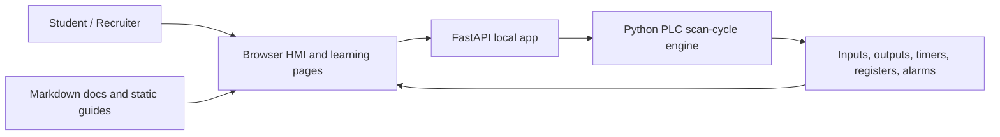

# Salbotics PLC Learning Hub

[](LICENSE)
[](https://www.python.org/)
[](https://fastapi.tiangolo.com/)
[](#phase-roadmap)

An open educational product by **Salbotics Solutions**: one portable place to learn PLC logic, Ladder thinking, industrial HMI basics, oil-palm automation context, and safety-awareness basics.

This repo is built to be useful for learners and visible for recruiters: it shows practical automation thinking, a working local simulator, SCADA-style UI design, test coverage, documentation, and a clear roadmap.

## Public Links

- Product / company site: [salbotics.uk](https://salbotics.uk/)
- GitHub repo target: [SaladinIART/salbotics-plc-learning-hub](https://github.com/SaladinIART/salbotics-plc-learning-hub)
- Static demo target: [GitHub Pages demo](https://saladiniart.github.io/salbotics-plc-learning-hub/)
- Portfolio: `TODO: add portfolio URL before public launch`

## Screenshots

PLC/HMI dashboard:


Ladder scenario guide:


Oil-palm industrial environment:


Programming methods and flowcharts:


## What You Can Learn

- PLC scan cycle: read inputs, solve logic, write outputs.
- Ladder basics: contacts, coils, run latch, timers, interlocks.
- Safe traffic-light phase sequencing with all-red gaps.
- Browser HMI basics: I/O address tables, timer/register tables, rung monitor, field view, alarms, and event log.
- Industrial realism: Omron/Siemens examples, analog modules, VFD motor control, NPN/PNP sensors, and troubleshooting.
- Oil-palm factory context: FFB to CPO process flow, conveyor handling, WECON/PAC/Raspberry Pi/Arduino station comparisons, IIoT, and safety/regulatory awareness.
- Phase 2 communications overview: SCADA/HMI roles, RS-232/RS-485/Ethernet, Modbus RTU/TCP, OPC UA, MQTT/Sparkplug, local server basics, and oil-palm SCADA screen design.
- Phase 3 local analytics: simulated oil-palm data collection, SQLite historian, management KPIs, trends, events, OT/IT/MES/ERP concepts, and screw press station deep dive.
- Reliable PLC programming method: flowcharts first, LAD first, then compare ST/FBD/SFC.
- Machinery safety-awareness path: risk-assessment qualification meaning, certification options, timing, cost ranges, and deliverables.

## Architecture



The live simulator runs locally. The static demo is for browsing learning content without exposing live PLC-control endpoints on the public web.

## Download And Open On Windows

Use this path if you are not cloning with Git yet.

1. Open the GitHub repository page.
2. Click the green **Code** button.
3. Click **Download ZIP**.
4. Right-click the downloaded ZIP file and choose **Extract All...**.
5. Open the extracted folder.
6. Double-click `start-plc-trainer.bat`.
7. Wait while the launcher creates `.venv` and installs Python dependencies.
8. Your browser should open `http://127.0.0.1:8733`.
9. Keep the server window open while using the trainer.

If Phase 3 analytics says **NO DATA** and the server window shows `404` for `/api/analytics/*`, an old server is probably still running on port `8733`. Run `start-plc-trainer.bat` again and choose `Y` when it asks whether to stop the existing process and restart this trainer.

## Current Platform And Hardware Limits

- Designed and tested first for **Windows 10/11**.
- Requires **Python 3.11 or newer** and a modern browser.
- First launch needs internet access to install `requirements.txt`.
- The one-click launcher is currently Windows `.bat` only.
- Linux/macOS launch scripts are not included yet.
- No PLC, relay, VFD, sensor, COM port, RS-232 adapter, Arduino, Raspberry Pi, or industrial hardware is required.
- Phase 3 analytics uses local simulated oil-palm data stored in SQLite under `local_data/`.
- This project is educational and local-first; it is not a certified industrial controller, safety system, public SCADA server, or production historian.

## Run Locally

Windows single-click launcher:

```text
start-plc-trainer.bat
```

Manual run:

```powershell
python -m venv .venv
.\.venv\Scripts\Activate.ps1
pip install -r requirements.txt
uvicorn main:app --host 127.0.0.1 --port 8733 --reload
```

Open:

```text
http://127.0.0.1:8733
```

Keep the host as `127.0.0.1` for normal learning. Do not change it to `0.0.0.0` or expose port `8733` to the internet unless you fully understand the security implications and have added proper authentication, firewall rules, and review.

## Test

```powershell
.\.venv\Scripts\python.exe -m pytest -q
```

## Frontend Spike

Phase 1 keeps the FastAPI simulator as the local runtime and adds an isolated Astro spike under `frontend/` for the future public learning hub.

```powershell
cd frontend
npm install
npm run build
```

The Astro build is static and is not a replacement for the local simulator yet.

## Learning Order

1. Read `docs/PLC_TRAINING_GUIDE.md`.
2. Run the app.
3. Open `/static/how-it-works.html` for scenario walkthroughs and Ladder diagrams.
4. Open `/static/industrial-situations.html` for realistic PLC brand, analog, VFD, and sensor troubleshooting situations.
5. Open `/static/oil-palm-industrial-environment.html` for the oil-palm process, conveyor handling, operating modes, LAD examples, and IIoT module.
6. Open `/static/oil-palm-control-stack-analysis.html` for WECON, PAC, Raspberry Pi industrial, and Arduino Opta/Portenta comparisons.
7. Open `/static/phase-2-start-here.html` for communications, SCADA/HMI, local server, and Phase 3 analytics overview.
8. Open `/static/phase-3-data-analytics.html` for local data collection, historian, management dashboard, OT/IT/MES/ERP, and analytics.
9. Open `/static/plc-programming-methods.html` for reliable PLC programming workflow, flowcharts, language comparisons, and case studies.
10. Open `/static/risk-assessment-certification.html` for machinery risk-assessment certification paths and budget ranges.
11. Return to `/`, press `START`, and observe the scan-cycle state changes.

## Phase Roadmap

Phase 1A: polish and publish the current static/FastAPI trainer.

- Rebrand as Salbotics PLC Learning Hub.
- Add license, attribution, public README, and static demo publishing notes.
- Keep simulator local and safe by default.

Phase 1B: staged frontend migration.

- Introduce Astro for reusable layouts, navigation, and content pages.
- Keep FastAPI as the local simulator runtime.
- Migrate one guide page first before moving the whole learning hub.

Phase 1C: interactive SVG learning islands.

- Add fluid SVG diagrams, guided scenarios, and interactive lessons where they improve understanding.
- Avoid heavy framework migration until the educational value is proven.

Phase 2: communications, SCADA/HMI, and local-server learning, simulated first.

- Add guided learning paths for operator, technician, and developer readers.
- Teach RS-232, RS-485, Ethernet, Modbus RTU/TCP, OPC UA, MQTT/Sparkplug, polling, registers/tags, timeouts, retries, and communication faults.
- Teach `127.0.0.1`, localhost, LAN IP, ports, firewall basics, and why live HMI controls stay local by default.
- Use the oil-palm factory case to explain plant overview, station, alarm, trend, maintenance, and network screens.
- Keep all protocol runtime simulated; no real PLC connection yet.

Phase 3: Python data extraction and analytics.

- Start with simulated oil-palm collection, SQLite local storage, historian/trend views, production counters, alarm statistics, OT/IT/MES/ERP concepts, and simple analytics.
- Use the management dashboard to explain why production, downtime, OER, alarms, energy, and repeated faults matter to business decisions.
- Add virtual Modbus TCP after learners understand local historian/dashboard value.
- Add OPC UA/MQTT after learners understand tags/registers.
- Add pySerial / RS-232 later as a focused legacy machinery track.

## Safety Boundary

This is educational software. It is not certified traffic-control, machinery-safety, process-safety, boiler, pressure-protection, or industrial-control software.

Use qualified engineering review, applicable standards, site procedures, certified components, and local authority requirements before changing real machinery or control systems.

## Security Notes For Public Users

- The default launcher binds to `127.0.0.1`, meaning this computer only.
- API buttons can change simulator state, so the live FastAPI app should stay local.
- The app does not include authentication because it is not intended to be hosted as a public control panel.
- The SQLite historian is local demo data and is ignored by Git.
- Do not put credentials, real plant IP addresses, production recipes, or customer data into this repo.
- Public demos should prefer static pages/screenshots instead of exposing live `/api/inputs`, `/api/commands`, or analytics reset endpoints.

## License And Attribution

- Licensed under the MIT License. See `LICENSE`.
- Original product and training concept by **Salbotics Solutions**. See `NOTICE`.
- Please credit **Salbotics PLC Learning Hub by Salbotics Solutions** when teaching from, demonstrating, or publishing derived work based on this project.
