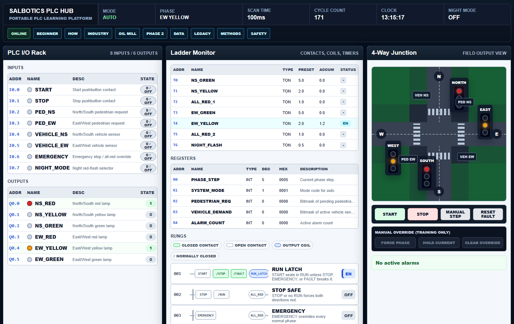
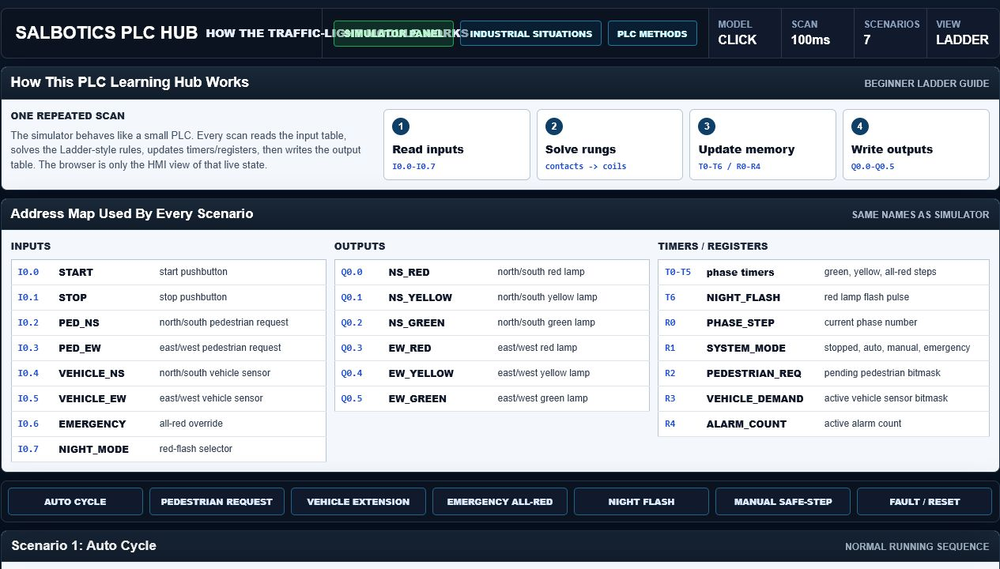
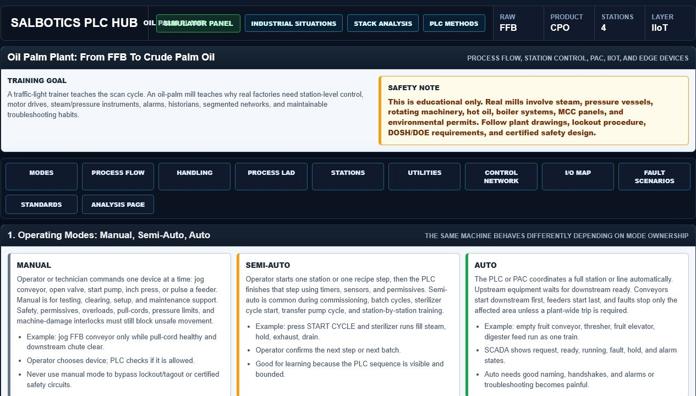
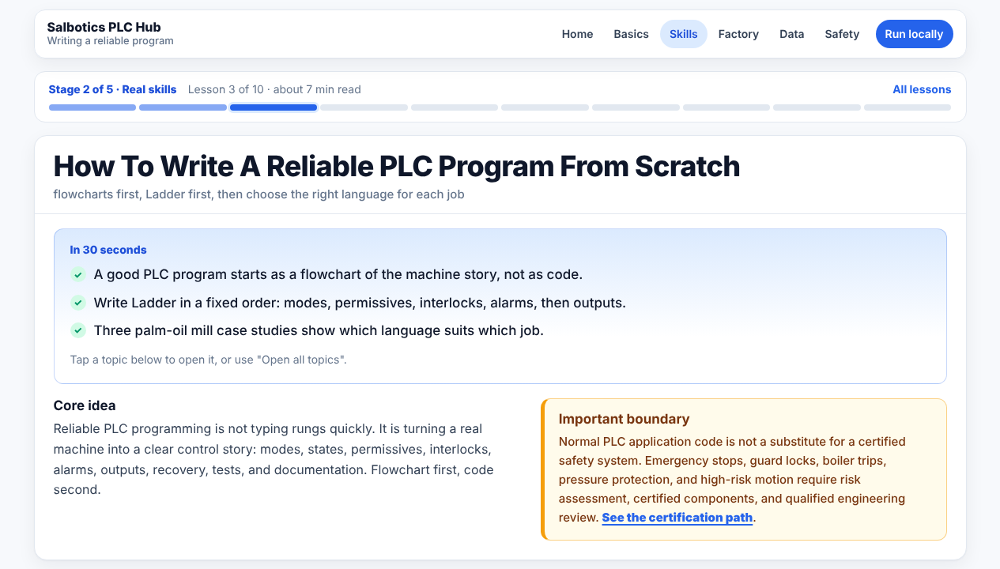
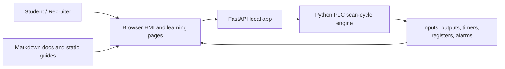

# Salbotics PLC Learning Hub

[](LICENSE)
[](https://www.python.org/)
[](https://fastapi.tiangolo.com/)
[](#phase-roadmap)

An open educational product by **Salbotics Solutions**: one portable place to learn PLC logic, Ladder thinking, industrial HMI basics, oil-palm automation context, and safety-awareness basics.

This repo is built to be useful for learners and visible for recruiters: it shows practical automation thinking, a working local simulator, SCADA-style UI design, test coverage, documentation, and a clear roadmap.

## Public Links

- Product / company site: [salbotics.uk](https://salbotics.uk/)
- GitHub repo target: [SaladinIART/salbotics-plc-learning-hub](https://github.com/SaladinIART/salbotics-plc-learning-hub)
- Static demo target: [GitHub Pages demo](https://saladiniart.github.io/salbotics-plc-learning-hub/)
- Portfolio: `TODO: add portfolio URL before public launch`

## Screenshots

PLC/HMI dashboard:



Ladder scenario guide:



Oil-palm industrial environment:



Programming methods and flowcharts:



## What You Can Learn

- PLC scan cycle: read inputs, solve logic, write outputs.
- Ladder basics: contacts, coils, run latch, timers, interlocks.
- Safe traffic-light phase sequencing with all-red gaps.
- Browser HMI basics: I/O address tables, timer/register tables, rung monitor, field view, alarms, and event log.
- Industrial realism: Omron/Siemens examples, analog modules, VFD motor control, NPN/PNP sensors, and troubleshooting.
- Oil-palm factory context: FFB to CPO process flow, conveyor handling, WECON/PAC/Raspberry Pi/Arduino station comparisons, IIoT, and safety/regulatory awareness.
- Reliable PLC programming method: flowcharts first, LAD first, then compare ST/FBD/SFC.
- Machinery safety-awareness path: risk-assessment qualification meaning, certification options, timing, cost ranges, and deliverables.

## Architecture



The live simulator runs locally. The static demo is for browsing learning content without exposing live PLC-control endpoints on the public web.

## Run Locally

Windows single-click launcher:

```text
start-plc-trainer.bat
```

Manual run:

```powershell
python -m venv .venv
.\.venv\Scripts\Activate.ps1
pip install -r requirements.txt
uvicorn main:app --host 127.0.0.1 --port 8733 --reload
```

Open:

```text
http://127.0.0.1:8733
```

## Test

```powershell
.\.venv\Scripts\python.exe -m pytest -q
```

## Frontend Spike

Phase 1 keeps the FastAPI simulator as the local runtime and adds an isolated Astro spike under `frontend/` for the future public learning hub.

```powershell
cd frontend
npm install
npm run build
```

The Astro build is static and is not a replacement for the local simulator yet.

## Learning Order

1. Read `docs/PLC_TRAINING_GUIDE.md`.
2. Run the app.
3. Open `/static/how-it-works.html` for scenario walkthroughs and Ladder diagrams.
4. Open `/static/industrial-situations.html` for realistic PLC brand, analog, VFD, and sensor troubleshooting situations.
5. Open `/static/oil-palm-industrial-environment.html` for the oil-palm process, conveyor handling, operating modes, LAD examples, and IIoT module.
6. Open `/static/oil-palm-control-stack-analysis.html` for WECON, PAC, Raspberry Pi industrial, and Arduino Opta/Portenta comparisons.
7. Open `/static/plc-programming-methods.html` for reliable PLC programming workflow, flowcharts, language comparisons, and case studies.
8. Open `/static/risk-assessment-certification.html` for machinery risk-assessment certification paths and budget ranges.
9. Return to `/`, press `START`, and observe the scan-cycle state changes.

## Phase Roadmap

Phase 1A: polish and publish the current static/FastAPI trainer.

- Rebrand as Salbotics PLC Learning Hub.
- Add license, attribution, public README, and static demo publishing notes.
- Keep simulator local and safe by default.

Phase 1B: staged frontend migration.

- Introduce Astro for reusable layouts, navigation, and content pages.
- Keep FastAPI as the local simulator runtime.
- Migrate one guide page first before moving the whole learning hub.

Phase 1C: interactive SVG learning islands.

- Add fluid SVG diagrams, guided scenarios, and interactive lessons where they improve understanding.
- Avoid heavy framework migration until the educational value is proven.

Phase 2: communications and hardware learning, intentionally on hold.

- pySerial / virtual COM lessons.
- Modbus RTU/TCP.
- OpenPLC runtime bridge.
- MQTT / OPC UA / IIoT gateway lessons.

## Safety Boundary

This is educational software. It is not certified traffic-control, machinery-safety, process-safety, boiler, pressure-protection, or industrial-control software.

Use qualified engineering review, applicable standards, site procedures, certified components, and local authority requirements before changing real machinery or control systems.

## License And Attribution

- Licensed under the MIT License. See `LICENSE`.
- Original product and training concept by **Salbotics Solutions**. See `NOTICE`.
- Please credit **Salbotics PLC Learning Hub by Salbotics Solutions** when teaching from, demonstrating, or publishing derived work based on this project.
